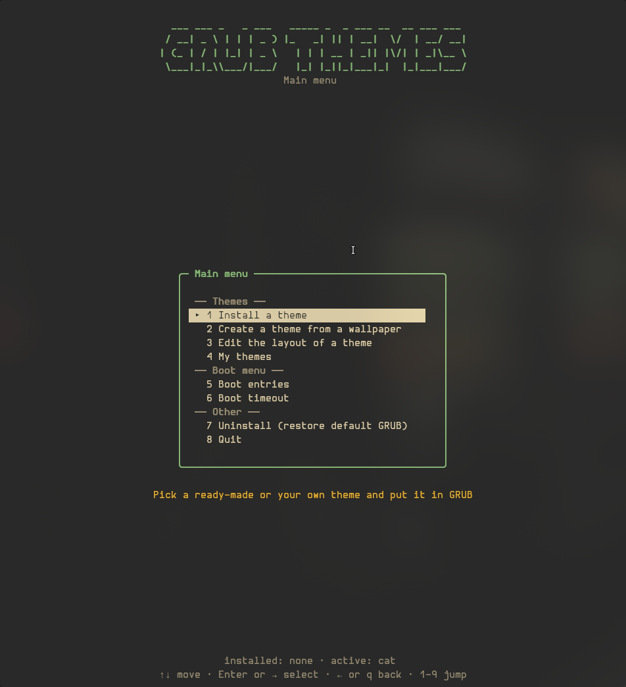
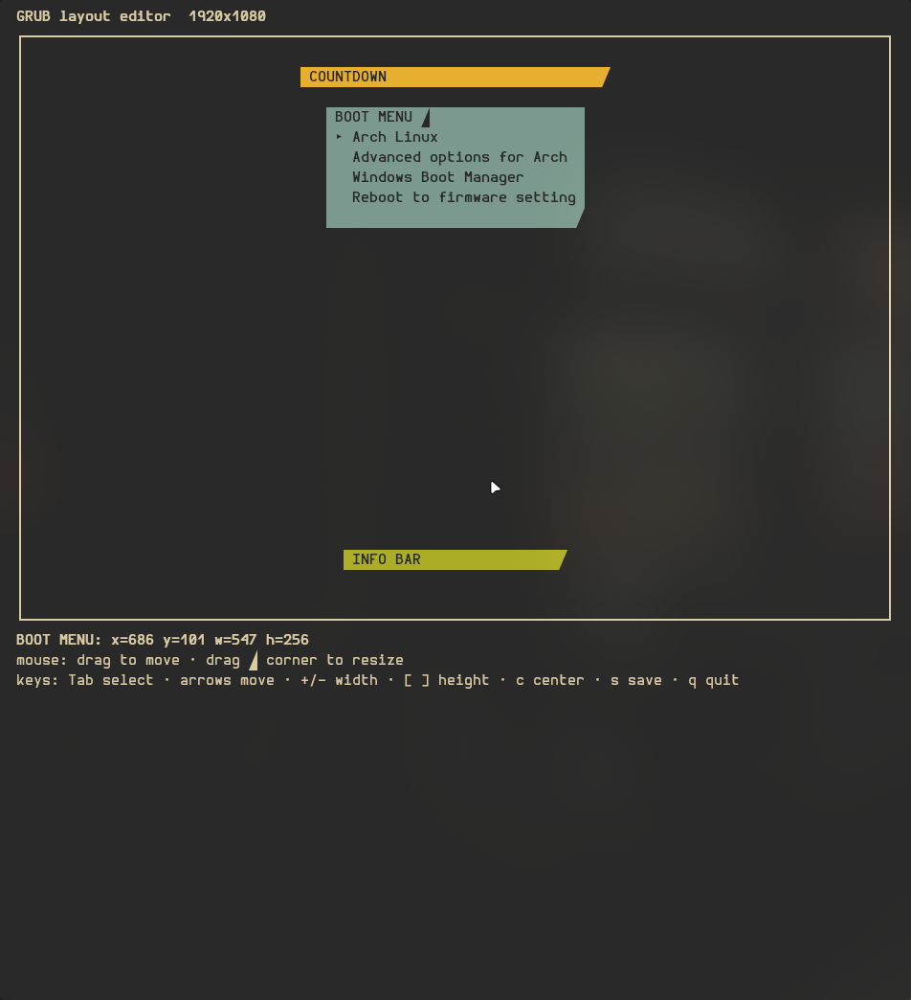
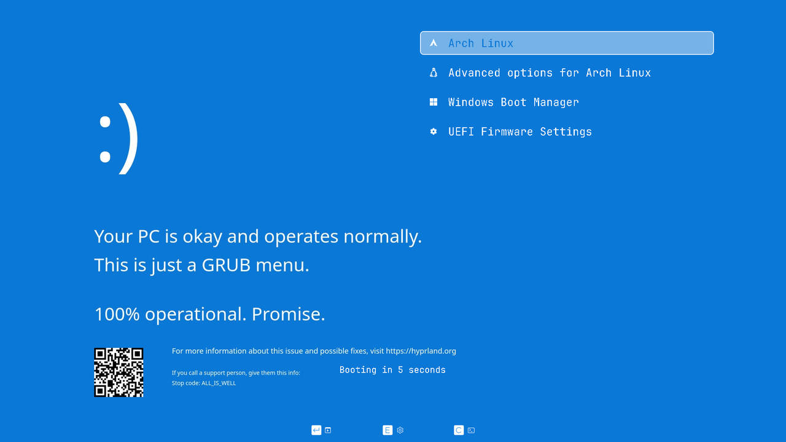
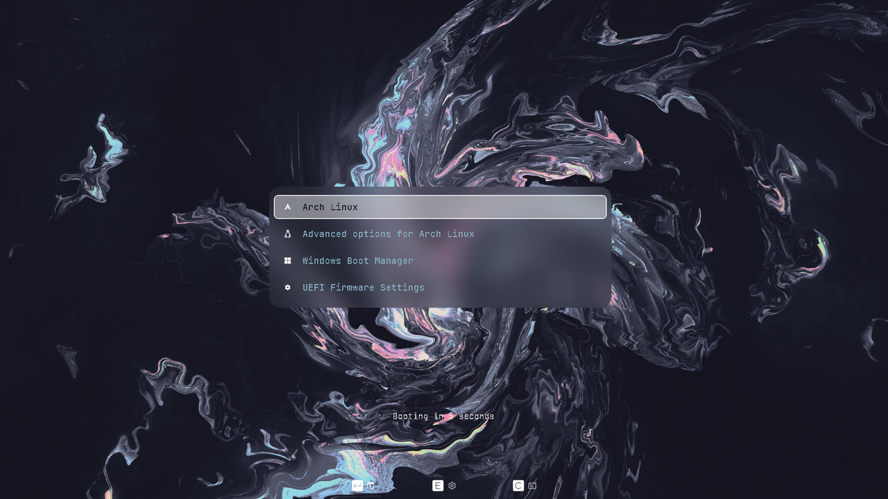
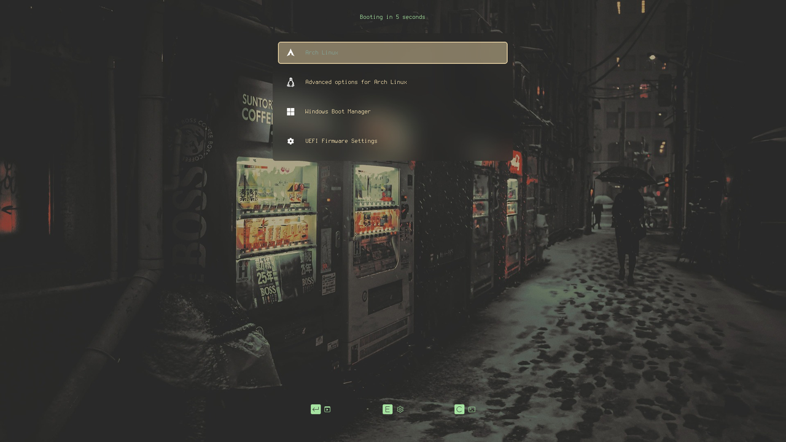

# GRUB Theme tui

A terminal interface to install, create, edit, and manage GRUB themes. Based on [grub2-themes](https://github.com/vinceliuice/grub2-themes).

<p align="center">
  
  
</p>
<p align="center">
  
  
  
</p>
## Requirements

**Warning:** Pillow is required to run the TUI and create or edit themes. Install it with `pip install -r requirements.txt`.

Bash, sudo, GRUB, and Python 3 are also required.

## TUI

```sh
./grub-tui.sh
```

Install bundled themes, create themes from wallpapers, edit layouts and appearance, or uninstall themes. Previews update when you make changes.

## Install from the command line

```sh
sudo ./install.sh -t gruvbox                  # install a theme
sudo ./install.sh -t windows -c 2560x1440     # set resolution (any WxH)
sudo ./install.sh -r gruvbox                  # remove a theme
./install.sh -l                               # list themes
```

Options: `-t THEME` install (default: gruvbox), `-c WxH` set resolution, `-i SET` choose icons, `-r THEME` remove, `-s` sync boot entries, `-T SECS` set timeout (`-1` waits forever), `-U` uninstall all themes and restore defaults, `-g DIR` copy a theme to a directory, `-l` list themes, `-u` open the menu, `-h` show help. Run `./install.sh -h` for details.

## Create a theme

Set its name and wallpaper, then build and install it:

```sh
./grub-custom.py set name mytheme
./grub-custom.py set wallpaper ~/pic.jpg
./grub-custom.py build
sudo ./install.sh -t mytheme
```

Set appearance before building:

```sh
./grub-custom.py set name dark
./grub-custom.py set wallpaper ~/pic.jpg
./grub-custom.py set resolution 2560x1440
./grub-custom.py set card_style full
./grub-custom.py set card_color "#1e1e2e"
./grub-custom.py set text "#cdd6f4"
./grub-custom.py set selected_text "#1e1e2e"
./grub-custom.py set highlight "#89b4fa"
./grub-custom.py set radius 20
./grub-custom.py build
sudo ./install.sh -t dark -c 2560x1440
```

For a glass card, invisible highlight, and custom countdown:

```sh
./grub-custom.py set name glass
./grub-custom.py set card_style blurry
./grub-custom.py set highlight_style invisible
./grub-custom.py set timeout_text "Booting in %d..."
./grub-custom.py build
```

`set KEY VALUE` supports:

| Setting | Accepted values |
|---|---|
| `name` | Letters, digits, `-`, `_` |
| `wallpaper` | `png`, `jpg`, `webp`, `bmp`, `gif`, `tiff` |
| `resolution` | Any `WxH` (e.g. `1920x1080`, `2560x1440`, `3440x1440`, `3840x2160`) |
| `card_style`, `highlight_style` | `blurry`, `full`, `invisible` |
| `card_color`, `text`, `selected_text`, `highlight`, `info_color`, `timeout_color` | `#rrggbb` |
| `radius` | `0–80` |
| `font_size` | `12–64` |
| `item_spacing` | `0–40` |
| `icon_size` | `16–96` |
| `entries` | `auto` or a number |
| `timeout_text` | Include `%d` once |

Settings are saved in `~/.cache/grub-theme-tui/working.json`. Build creates `themes/<name>` and `previews/<name>.png`.

## Other commands

```sh
./grub-custom.py show              # show settings
./grub-custom.py get KEY           # show one setting
./grub-custom.py resolutions       # list common resolutions
./grub-custom.py list              # list themes
./grub-custom.py preview [THEME]   # preview one or all themes
./grub-custom.py layout            # edit the current layout
./grub-custom.py delete NAME       # delete a created theme
```

You can also edit `themes/<name>/theme.txt` by hand, then reinstall the theme.

Original themes by Vince Liuice. GPL-3.0.
